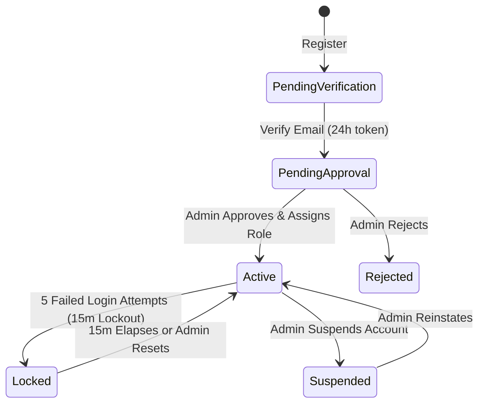

# Authentication & Account Security Architecture

## 1. Overview & Threat Model

Sentinel Vision AI implements a defense-in-depth security model compliant with statutory criminal justice data protection requirements (CJIS). The platform strictly adheres to zero-trust architecture:

- **Zero Client-Side Token Persistence**: Web clients never store bearer access tokens in `localStorage` or `sessionStorage`. Tokens are kept strictly in JavaScript memory (`Zustand` store) and wiped on page unload or logout.
- **Strict HTTP-Only Cookies**: Refresh tokens are stored exclusively in secure, HTTP-only, SameSite=Lax cookies scoped to `/api/v1/auth`.
- **Zero Secrets in Repository**: All private keys, HMAC secrets, and API credentials are injected strictly via validated environment variables (`env.validation.ts`). Pre-commit hooks (`gitleaks`) prevent secret leaks.

---

## 2. Token Matrix & Lifetimes

| Token Name | Format | Lifetime | Audience (`aud`) | Storage | Purpose |
| :--- | :--- | :--- | :--- | :--- | :--- |
| **Web Access Token** | Signed JWT (HS256) | 15 Minutes | `web` | In-Memory (Zustand) | Authorizes REST endpoints & WebSocket connections. |
| **Web Refresh Token** | Random 256-bit token + UUID family | 30 Days (Rolling) | N/A | HttpOnly Cookie (`sentinel_rt`) | Rotated single-flight silent session renewal. |
| **Mobile Access Token**| Signed JWT (HS256) | 15 Minutes | `mobile` | In-Memory (PWA store) | Scopes: `mobile:profile`, `mobile:devices`, `mobile:stream`. |
| **Mobile Refresh Token**| Random 256-bit token + UUID family | 30 Days | N/A | HttpOnly Cookie (`sentinel_m_rt`) | Rotated renewal for field operators. |
| **WHIP Publish Token** | Signed JWT (HS256) | 5 Minutes | `mobile` | URL param / Auth header | Single-path ingest (`cam/{cameraId}`) for MediaMTX WHIP hook. |
| **Email Verification** | Cryptographic Hex (SHA-256 in DB) | 24 Hours | N/A | Mongo `auth_tokens` | Single-use email ownership validation. |
| **Password Reset** | Cryptographic Hex (SHA-256 in DB) | 30 Minutes | N/A | Mongo `auth_tokens` | Single-use password update authorization. |

---

## 3. Refresh Token Family Rotation & Reuse Detection

Sentinel uses refresh token rotation to mitigate token interception:

1. **Family Isolation**: Every initial login creates a unique `familyId` UUID.
2. **Atomic Invalidation & Rotation**: When `/auth/refresh` is called, the provided token secret is verified against the hash stored in MongoDB/Redis. A new token secret is immediately generated and written, invalidating the old token secret.
3. **Replay Detection & Auto-Revocation**: If an attacker attempts to replay an already-consumed refresh token within that family, the server detects token reuse, flags a potential breach, and **immediately revokes all active sessions in the family**. The user's account is flagged and security alert emails are dispatched.

---

## 4. Account Lifecycle & Brute Force Lockout

- **Brute Force Lockout**: Accounts with 5 consecutive incorrect password submissions are locked for 15 minutes.
- **Timing Safe Verification**: Authentication queries execute constant-time dummy argon2 hashes when a username does not exist to prevent user enumeration via timing analysis.

---

## 5. Multi-Factor Authentication (MFA / 2FA)

- **Algorithm**: Standard RFC 6238 TOTP (SHA-1, 30-second step, 6-digit output).
- **Setup Flow**:
  1. POST `/api/v1/auth/mfa/setup` generates a random base32 secret and QR code data URI.
  2. The user scans the QR code in Google Authenticator, 1Password, or Authy.
  3. POST `/api/v1/auth/mfa/enable` with a valid TOTP code activates 2FA on the user document.
  4. The server returns **8 emergency backup recovery codes** (e.g. `A1B2-C3D4`), stored in database hashed via SHA-256.
- **Emergency Access**: If the user loses their mobile authenticator, any unused recovery code acts as a single-use authentication factor, which is immediately struck from the database upon use.

---

## 6. MediaMTX External Authentication & Mobile Streaming

MediaMTX delegates publishing and playback authorization to Sentinel via HTTP POST `/api/v1/media/auth`:

1. **Publish Hook (`action: publish`)**:
   - Matches stream path `cam/{cameraId}`.
   - Verifies bearer publish JWT with `aud: 'mobile'`, `action: 'publish'`, and matching `cameraId`.
   - Validates that the token's `jti` is active in Redis (`mobile:publish_jti:{jti}`) and has not been revoked.
2. **TURN / ICE Credentials**:
   - Mobile operators acquire dynamic ephemeral TURN credentials generated via HMAC-SHA1 from `TURN_SECRET`.

---

## 7. Role-Based Access Control (RBAC)

| Role | Dashboard | Tracking | Cases | Sightings Review | Evidence Export | Admin Settings |
| :--- | :---: | :---: | :---: | :---: | :---: | :---: |
| `super_admin` | Full | Full | Full | Full | Full | Full |
| `investigator`| Full | Full | Full | Full | Full | Read Only |
| `reviewer` | Read Only | Read Only | Read Only | Confirm / Reject | Read Only | No Access |
| `viewer` | Read Only | Read Only | Read Only | Read Only | No Access | No Access |
| `mobile_operator` | N/A (PWA) | N/A (PWA) | N/A | N/A | N/A | N/A |
