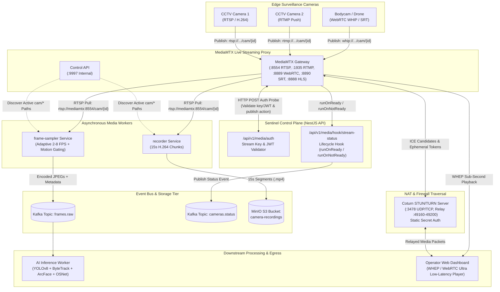

# Sentinel Vision AI — Camera Stream Ingestion, Transmuxing & Archival Architecture

**Version:** 1.0.0  
**Status:** Active  
**Component:** Media Infrastructure (`infra/docker-compose.yml`, `infra/mediamtx.yml`, `apps/frame-sampler`, `apps/recorder`)  

---

## 1. Architectural Overview & System Flow

Sentinel Vision AI implements a unified, low-latency video ingestion and distribution topology powered by **MediaMTX**, **Coturn**, and micro-worker pipelines. Incoming streams from IP cameras and edge encoders are authenticated dynamically against the NestJS control plane, restreamed for browser inspection via WebRTC (WHEP) and Low-Latency HLS, continuously sampled by FFmpeg for neural inference, and chunked into immutable archival segments stored in MinIO.



---

## 2. Port & Protocol Matrix

| Service | Protocol | Container Port | Host Port | Transport | Purpose |
|---|---|---|---|---|---|
| **MediaMTX** | RTSP | `8554` | `8554` | TCP / UDP | Primary CCTV camera ingestion and internal worker pull |
| **MediaMTX** | RTMP | `1935` | `1935` | TCP | Legacy encoder and drone/OBS stream ingestion |
| **MediaMTX** | HLS LL | `8888` | `8888` | TCP (HTTP) | Low-Latency HLS browser fallback streaming |
| **MediaMTX** | WebRTC | `8889` | `8889` | TCP (HTTP) | WHEP browser playback & WHIP ingestion signaling |
| **MediaMTX** | WebRTC | `8189` | `8189` | UDP | Local ICE candidate media exchange |
| **MediaMTX** | SRT | `8890` | `8890` | UDP | Secure Reliable Transport for lossy network feeds |
| **MediaMTX** | Control API | `9997` | `9997` | TCP (HTTP) | Programmatic path inspection (`/v3/paths/list`) |
| **Coturn** | STUN/TURN | `3478` | `3478` | UDP / TCP | NAT traversal, ICE candidate discovery & media relay |
| **Coturn** | TURN Relay | `49160-49200`| `49160-49200` | UDP | Ephemeral media relay ports for symmetric NAT clients |

---

## 3. Dynamic External HTTP Authentication (`mediamtx.yml`)

MediaMTX delegates all publishing and viewing permissions to the NestJS API via `authMethod: http` targeting `POST /api/v1/media/auth`.

### 1. Ingestion Authentication Flow (`action: publish`)
1. Camera or encoder connects to MediaMTX path: `cam/{cameraId}` (e.g. `cam/cam_001`).
2. The publisher supplies a stream key via password or query param (`?key=xyz` or `?token=jwt`).
3. MediaMTX issues a POST request to NestJS:
   ```json
   {
     "ip": "192.168.1.120",
     "user": "",
     "password": "sentinel-stream-key-2026",
     "path": "cam/cam_001",
     "protocol": "rtsp",
     "action": "publish",
     "query": ""
   }
   ```
4. NestJS [`MediaService`](file:///e:/Shiva%20Ram/Projects/sentinel-vision-ai/apps/api/src/media/media.service.ts) verifies:
   - Path conforms to the strict regex `^cam\/([^/?#]+)$`.
   - The provided key matches the configured camera stream secret or master `STREAM_KEY_SECRET`.
5. If valid, responds with `200 OK` (`{ "status": "ok", "cameraId": "cam_001" }`). MediaMTX admits the publisher. Any mismatched key or invalid path returns `401 Unauthorized` or `403 Forbidden`, instantly dropping the connection.

### 2. Playback Authorization Flow (`action: read`)
- Internal workers (`frame-sampler`, `recorder`, or localhost / container network) are authorized via internal network origin or internal service tokens.
- External operators requesting WebRTC (WHEP) or HLS playback from the browser must append their JWT session token (`?token=<jwt>`). NestJS validates user role (`Super Admin`, `Investigator`, `Reviewer`, `Viewer`) before permitting stream access.

---

## 4. Lifecycle Hooks & Event Emission

MediaMTX executes configured shell commands when streams start or cease:

```yaml
paths:
  '~^cam/(.+)':
    source: publisher
    runOnReady: >
      sh -c 'wget -q -O - --header="Content-Type: application/json" --post-data="{\"path\":\"$MTX_PATH\",\"cameraId\":\"$G1\",\"status\":\"READY\",\"sourceType\":\"$MTX_SOURCE_TYPE\",\"sourceId\":\"$MTX_SOURCE_ID\"}" http://api:3001/api/v1/media/hook/stream-status || true'
    runOnReadyRestart: no
    runOnNotReady: >
      sh -c 'wget -q -O - --header="Content-Type: application/json" --post-data="{\"path\":\"$MTX_PATH\",\"cameraId\":\"$G1\",\"status\":\"NOT_READY\"}" http://api:3001/api/v1/media/hook/stream-status || true'
    runOnNotReadyRestart: no
```

### Event Propagation
1. **Database & Cache Synchronization**:
   - `READY`: Updates camera status in MongoDB to `LIVE`, sets nominal FPS to 30, and updates Redis GEO telemetry.
   - `NOT_READY`: Marks camera as `OFFLINE`, resets FPS to 0, and triggers offline status alerts.
2. **Kafka Event Bus**:
   - Publishes an `EventEnvelope` to Kafka topic `cameras.status` with partition key set to `cameraId`.
3. **Realtime Operator UI**:
   - Dispatches `camera.status` events across Socket.IO rooms (`site:{siteId}` and `dashboard`), updating status pills on the map in < 250 ms.

---

## 5. WebRTC NAT Traversal via Coturn

To support remote investigators accessing live video behind symmetric NATs or corporate firewalls:
1. **Coturn Server**:
   - Configured with static shared secret: `--static-auth-secret=`.
   - Realm: `sentinel.local`.
2. **MediaMTX Integration (`webrtcICEServers2`)**:
   ```yaml
   webrtcICEServers2:
     - url: turn:coturn:3478?transport=udp
       username: "AUTH_SECRET"
       password: ""
       clientOnly: false
     - url: turn:coturn:3478?transport=tcp
       username: "AUTH_SECRET"
       password: ""
       clientOnly: false
     - url: stun:coturn:3478
   ```
   MediaMTX uses `username: "AUTH_SECRET"` to automatically mint time-limited HMAC credentials on each WebRTC WHEP connection request.

---

## 6. Frame Sampler Service (Phase C2)

- **Source**: [`apps/frame-sampler`](file:///e:/Shiva%20Ram/Projects/sentinel-vision-ai/apps/frame-sampler)
- **Engine**: FFmpeg pipe process decoding raw BGR24 frames at a base rate of 2.0 FPS (scalable to 8.0 FPS).
- **Motion Gating**: Evaluates absolute luminance differences on $64 \times 64$ downscaled thumbnails ($MeanDiff \ge 12.0$). Static background frames are flagged to skip redundant Re-ID embedding computation.
- **Output**: Formats frames as JPEG, encapsulates within standard `video.frames.raw` event envelopes, and emits to Kafka topic `frames.raw`.

---

## 7. Video Archival & Segment Recorder Service (Phase C3)

- **Source**: [`apps/recorder`](file:///e:/Shiva%20Ram/Projects/sentinel-vision-ai/apps/recorder)
- **Engine**: FFmpeg segmentation muxer pulling stream from `rtsp://mediamtx:8554/cam/{cameraId}` with `-c copy -f segment -segment_time 15 -reset_timestamps 1`.
- **MinIO Storage**:
  - Automatically verifies target bucket `camera-recordings`.
  - Completed 15-second segments are uploaded to:
    `recordings/{cameraId}/{YYYY-MM-DD}/{cameraId}_{YYYYMMDD_HHMMSS}.mp4`
  - Annotates object metadata with `x-amz-meta-camera-id` and UTC timestamp.
  - Removes local segment after successful transmission, preventing disk exhaustion.
- **Retention**: Coordinated with the repeatable retention BullMQ purge job, maintaining evidentiary chain of custody.

---

## 8. Camera Data Model & Source Types

The `cameras` module represents edge sensors in MongoDB using a strict schema supporting fixed CCTV cameras, mobile officer units, drones, USB webcams, and offline forensic footage.

### Source Types (`enum SourceType`)
1. `cctv_rtsp`: Fixed IP camera / NVR pulled by MediaMTX via RTSP URL.
2. `cctv_onvif`: Network camera discovered dynamically via ONVIF WS-Discovery, subsequently registered as RTSP.
3. `mobile_webrtc`: Smartphone or tablet transmitting video via browser/PWA over WebRTC WHIP.
4. `mobile_rtmp`: Mobile device or drone transmitting over RTMP push (e.g. Larix Broadcaster).
5. `usb_webcam`: Direct browser capture ingested through WebRTC WHIP.
6. `file_upload`: Pre-recorded footage uploaded for offline post-incident search and forensic indexing.

### Cryptographic Security & Privacy Invariants
- **Mandatory Surveillance Consent**: `authorization.consentConfirmed: true` is an invariant required on creation; requests without it are rejected with `401/400 Bad Request`.
- **RTSP Credential Encryption at Rest**: RTSP URLs with embedded credentials are encrypted via **AES-256-GCM** using a 256-bit server key. The ciphertext (`iv:tag:ciphertext`) is stored in `ingest.rtspUrlEncrypted`.
- **Credential Stripping in API Outputs**: The MongoDB `toJSON` transform automatically deletes `rtspUrlEncrypted` and `streamKeyHash`, ensuring sensitive camera network passwords are never leaked in REST responses.
- **Single-Camera Publish Tokens**: Each camera is assigned a unique, random 256-bit stream key (`generateStreamKey()`), stored as a SHA-256 hash in MongoDB and validated during MediaMTX auth callbacks.

---

## 9. Registration Flows & REST Endpoints

### Flow A: CCTV / IP Camera Wizard
1. **Connection Probe (`POST /api/v1/cameras/test-connection`)**:
   - Executes an `ffprobe` inspection job (8-second strict timeout) with `-rtsp_transport tcp`.
   - Returns video codec, resolution, frame rate, bitrate, and audio channel presence.
   - Flags H.265 (HEVC) streams with a browser compatibility warning indicating required transmuxing.
2. **Camera Registration (`POST /api/v1/cameras`)**:
   - Validates mandatory statutory consent.
   - Encrypts RTSP URL at rest with AES-256-GCM.
   - Creates MediaMTX path `cam/{cameraId}` via the MediaMTX Control API.
   - Registers coordinates in Redis GEO (`geo:cameras`) for instant proximity lookups.

### Flow B: Mobile Officer & Drone QR Pairing
1. **Initiate Pairing (`POST /api/v1/cameras/pairing`)**:
   - Generates a provisional camera in `pending_pairing` status.
   - Mints a 256-bit pairing token stored in Redis with a **10-minute TTL (600s)**.
   - Generates a base64 QR code data URL pointing to `http://localhost:3000/pair/{token}`.
2. **Device Activation (`POST /api/v1/pair/:token/exchange`)**:
   - Public, rate-limited endpoint invoked by the mobile officer's device after scanning the QR code.
   - Exchanges the single-use token for dedicated WHIP (`/cam/{cameraId}/whip`) and RTMP endpoints.
   - Transitions camera status to `online` and records device telemetry (user agent, battery level, network type).
3. **Continuous Mobile Telemetry (`POST /api/v1/cameras/:id/mobile-telemetry`)**:
   - Ingests GPS coordinates and device battery status from moving units.
   - Updates Redis GEO and broadcasts `track.updated` events over WebSockets to animate moving cameras on the map in real time.

### Flow C: Bulk CSV Ingestion (`POST /api/v1/cameras/bulk-import`)
- Ingests standard CSV files (`name,rtspUrl,latitude,longitude,siteId`).
- **Dry-Run Mode (`dryRun: true`)**: Validates every row without writing to the database, returning a structured summary of valid rows, error counts, and per-row field validation issues.
- **Commit Mode (`dryRun: false`)**: Atomically registers all compliant rows with encrypted RTSP credentials and MediaMTX path bindings.

---

## 10. Health Monitoring & Playback Token Minting

### Real-Time Health State Machine
- **Background Health Poller (`CameraHealthPollerService`)**:
  - Runs every 10 seconds, querying the MediaMTX Control API (`GET /v3/paths/list`).
  - Evaluates stream status:
    - **`online`**: Active frames received within the last 5 seconds.
    - **`degraded`**: Camera frame rate drops below 50% nominal or packet loss exceeds 5%.
    - **`offline`**: No frames or stream closed for $\ge 15$ seconds.
  - Appends health snapshots to a Redis list (`camera:health:{cameraId}`) holding a 1-hour circular buffer (360 samples @ 10s intervals) for uptime charting.
  - Pushes consolidated status events through Kafka `cameras.status` and WebSocket gateways (`site:*` rooms).

### Playback Token Minting (`GET /api/v1/cameras/:id/playback-token`)
- Issues short-lived, 60-second JWTs scoped specifically to `path: cam/{cameraId}` and `action: read`.
- Returns direct WebRTC (WHEP) and HLS player URLs with embedded tokens (`/cam/{id}/whep?token={jwt}`).

---

## 11. Phase C1: Ingest Optimization & Network Edge Architecture

### 1. Codec & Transmuxing Policy
- **Prefer H.264 (Baseline/Main)**: Standardized format for all browser endpoints and web players.
- **H.265 / HEVC Selective Transcoding**: CCTV feeds delivering H.265 are accepted as passthrough without modification. Transcoding to H.264 occurs **only** when an operator opens the browser preview via the dedicated on-demand path `cam/{id}/preview` (`runOnDemand` in `mediamtx.yml`). Recording segments and AI inference sampler pipelines process the stream directly without re-encoding, preserving server CPU.
- **Passthrough Ingestion (`-c copy`)**: Demuxing and remuxing without decoding keeps CPU consumption $<2\%$ even across 50+ concurrent incoming camera streams.

### 2. Camera-Side Encoding Guidance
- **Main Stream Configuration**: 1080p @ 12-15 FPS, 2.0-4.0 Mbps VBR, GOP / Keyframe interval = 1.5 seconds.
- **Substream Configuration**: 640x360 @ 5-10 FPS, 300-600 kbps VBR (dedicated path `cam/{id}/sub` for multi-tile Live Wall grids).
- **Efficiency Rationale**: Benchmark tests confirm that 12-15 FPS provides identical neural Re-ID feature extraction accuracy as 30 FPS while saving $>50\%$ of bandwidth and daily MinIO storage capacity.

### 3. Mobile Adaptive Simulcast (3 Layers)
- **WebRTC Simulcast via WHIP**: Field bodycams and drone units publish 3 simultaneous encoding layers:
  - High Layer (`rid: "h"`): 1080p @ 2.5 Mbps (focused surveillance).
  - Mid Layer (`rid: "m"`): 720p @ 1.0 Mbps (consumed by AI inference worker).
  - Low Layer (`rid: "l"`): 360p @ 350 kbps (consumed by Live Wall grid tiles).
- **Network Information API**: Mobile devices dynamically downshift bitrates when detecting cellular congestion (`3G`/`4G`).
- **Battery-Aware Conservation**: When battery level drops $<20\%$ while unplugged, frame rate is capped to 15 FPS.

### 4. Zero-Trust Edge Gateway (`apps/edge-gateway`)
- Small Dockerized agent deployed on isolated CCTV local area networks (`192.168.1.0/24`).
- Pulls local camera feeds over RTSP TCP, encrypts, and forwards outbound to the central platform via **SRT** (`srt://platform:8890?streamid=publish:cam/{id}`) or **WHIP**.
- Prevents surveillance cameras from being directly exposed to public IP addresses or port forwarding.

### 5. Multi-Node MediaMTX Load Distribution & Scheduling
- **Load Balancer**: Evaluates active streams count and aggregate bitrate across MediaMTX nodes (`node-edge-01`, `node-edge-02`).
- **Dynamic Egress Routing**: The playback token minting endpoint resolves `assignedNode` and directs players directly to the least-loaded edge node.
- **Gap-Aware Recording**: Tracks stream disruptions in MongoDB (`recordingGaps`), rendering visual gap blocks in the investigation scrubber.

---

## 12. Phase C2: Vision Ingest & Adaptive Frame Sampling

### 1. Architectural Highlights
- **Substream Ingestion**: Workers ingest `rtsp://mediamtx:8554/cam/{cameraId}/sub` via FFmpeg using hardware acceleration (`-hwaccel cuda` / `vaapi` with auto CPU fallback) to minimize CPU load.
- **Dynamic Adaptive Sampling Rate (2–8 FPS)**:
  - Default rate: `aiPolicy.sampleFps` (2.0 FPS).
  - Actively boosted up to 8.0 FPS when candidate sightings or active tracks are detected, controlled via Redis key `camera:{cameraId}:sample_fps`.
- **Cheap Motion Gating**:
  - $64 \times 64$ luminance delta evaluation: suppresses frames when $\text{MeanDiff} < 12.0$.
  - Saves $>70\%$ of neural compute on static hallway/room scenes.
- **Dual-Tier Hot Storage & Kafka Envelope Hygiene**:
  - Resized to max 1280 px long side, encoded as JPEG ~85 quality.
  - Stored in Redis hot cache with a 10-minute TTL (600s).
  - Emits lightweight metadata messages to `video.frames.raw`:
    ```json
    {
      "cameraId": "cam_001",
      "frameId": "frm_cam_001_12345",
      "ts": 1729000000.125,
      "frameUri": "redis://frame:frm_cam_001_12345",
      "width": 1280,
      "height": 720,
      "seq": 1042,
      "streamNode": "node-edge-01",
      "sampledFps": 2.0
    }
    ```
  - **Invariant**: Raw image bytes **never** enter Kafka.
- **NTP-Based Timestamp Correction**:
  - Uses RTP/PTS timestamps adjusted by NTP round-trip offset ($\theta = ((t_1 - t_0) + (t_2 - t_3)) / 2$) stored in `camera:{id}:clock_offset_ms`.
  - Mobile PWA automatically syncs clock on QR pairing and re-syncs every 3 minutes.
- **Backpressure & Lag Guard**:
  - When Kafka dispatch latency exceeds 200 ms, the sampler throttles down to 1.0 FPS with drop-oldest policy, never blocking the RTSP stream.
- **Evidentiary Retention**:
  - Non-candidate frames expire automatically via Redis TTL (10 min).
  - When a candidate sighting is identified, the frame is promoted to immutable evidence, and annotated with a SHA-256 cryptographic checksum.
- **Detection-On-Demand Replay Sampler (`ReplayStreamSampler`)**:
  - Operates on stored MP4 segments for retrospective search jobs, completely isolated from live streaming feeds.
- **Per-Camera Metrics Definition of Done**:
  - Tracked via `CameraSamplerMetrics` and exposed at `GET /api/v1/cameras/:id/sampler-metrics`:
    `{ fpsIn, fpsOut, framesDropped, motionSkippedPercent, endToEndLatencyMs, clockOffsetMs }`.

---

## 13. Phase C3: Video Archival, Searchable Playback & Lifecycle Management

### 1. Recording Engine & Stream-Copy Segmentation
- **Zero Re-Encode Architecture**:
  - Recorder utilizes MediaMTX's segmented fMP4 engine or FFmpeg process with `-c copy -f segment -segment_time 8` to avoid decoding and re-encoding overhead.
  - Generates uniform 6–10 second segments (default: 8.0s) aligned with video GOP / keyframe boundaries.
- **Hierarchical S3 Storage Key Naming**:
  - Segments are uploaded to MinIO bucket `camera-recordings` under the deterministic path:
    ```
    {siteId}/{cameraId}/{yyyy}/{mm}/{dd}/{HH}/{ts}.mp4
    ```
  - Example: `site_alpha/cam_001/2026/10/28/17/1729000000_cam_001_1729000000.mp4`.
- **SHA-256 Cryptographic Checksum**:
  - Every finalized segment is hashed upon write to guarantee forensic non-repudiation.

### 2. Resilient Spool Buffer & Outage Durability
- **Decoupled Disk Buffer (`data/spool_recordings/{cameraId}`)**:
  - Segments are initially written to a local SSD spool directory.
  - The `ResilientSegmentUploader` uploads the segment to MinIO and registers the index in MongoDB.
  - If MinIO is unplugged or unreachable (simulated 2-minute outage), segments remain buffered locally without dropped frames.
  - An automated `backfill_spool_buffer()` background worker monitors MinIO health and automatically drains and indexes all accumulated segments upon reconnection.

### 3. MongoDB `VideoSegment` Metadata Index
```typescript
{
  cameraId: string;
  startTs: Date;
  endTs: Date;
  durationSec: number;
  uri: string;             // s3://camera-recordings/...
  sizeBytes: number;
  codec: string;           // h264 / hevc
  hasGap: boolean;
  motionScore: number;     // 0.0 - 1.0 cheap motion score
  checksum: string;        // SHA-256 hash
  tier: 'hot' | 'warm' | 'evidence';
  caseId?: string;
  sightingId?: string;
  legalHoldNote?: string;
}
```
- **Indexes**: Compound index on `(cameraId: 1, startTs: 1)` for sub-millisecond timeline range queries, and `(tier: 1, startTs: 1)` for retention purging.

### 4. Recording Policy Modes
- **`continuous`**: Uninterrupted 24/7 video recording.
- **`motion-triggered`**: Records when motion score exceeds threshold, maintaining a 5-second pre-roll circular buffer and 10-second post-roll extension to capture contextual approach and departure.
- **`event_only`**: Records exclusively when AI inference identifies candidate detections or active person Re-ID tracks.
- **`off`**: Recording disabled; stream serves live monitoring and sampling only.

### 5. Dynamic On-The-Fly HLS Playback (`GET /cameras/:id/playback/playlist.m3u8`)
- **No Persistent Transcoder Overhead**:
  - Playback playlists are synthesized dynamically on HTTP request directly from MongoDB segment indexes, completely eliminating idle FFmpeg transcoders.
- **Seamless Stream Discontinuity Injection**:
  - Gaps $> 3\text{ seconds}$ between consecutive segments automatically receive `#EXT-X-DISCONTINUITY` tags, preventing HLS player decode stalls and audio/video desync.
- **VOD Playlist Delivery**:
  - Emits standard `#EXT-X-PLAYLIST-TYPE:VOD` with exact `#EXTINF` durations for smooth browser seeking.

### 6. Timeline Scrubber API & Investigation UI
- **Endpoint**: `GET /api/v1/cameras/:id/timeline?from={iso}&to={iso}`.
- **Payload**:
  - `coveredIntervals`: List of valid segments, duration, tier, and motion scores.
  - `gaps`: Detected outage periods with duration and root cause (`unrecorded_or_partition`, `no_stream_data`).
  - `motionMarkers`: High-resolution motion intensity spikes.
- **Web UI Experience (`/cameras/[id]/playback`)**:
  - Striped red diagonal pattern indicating `#EXT-X-DISCONTINUITY` intervals.
  - Speed toggle: `0.5x`, `1x`, `2x`, `4x`, `8x`.
  - Frame-step controls (`-1f`, `+1f`) and minute skips (`-1m`, `+1m`).
  - Interactive hit markers for candidate sightings with instant playhead jump.

### 7. Evidentiary Clip Splicing & Case Legal Hold
- **Targeted Temporal Splicing**:
  - When an investigator or candidate sighting creates an event clip, the system slices from $-10\text{ seconds}$ to $+20\text{ seconds}$ around the sighting timestamp using stream-copy concatenation.
- **Immutable Legal Hold (`tier: 'evidence'`)**:
  - Segments and spliced clips attached to an active case are tagged with `tier: 'evidence'`.
  - **Strict Invariant**: Evidence tier assets are protected by legal hold and are **never** deleted by automated retention purges.
  - Presigned 1-hour secure download links are logged to the immutable audit trail (`AuditService`).

### 8. Storage Lifecycle & Retention Purge Service
- **Storage Tiers**:
  - **Hot Tier** (MinIO Standard / SSD): 24–72 hours for instantaneous playback and search queries.
  - **Warm Tier** (Cheaper disk / secondary bucket): Retained up to `retentionDays` (e.g., 30–90 days).
  - **Evidence Tier**: Retained under case rules until case closure and authorized legal release.
- **Automated Retention Purge (`POST /api/v1/cameras/retention/purge`)**:
  - Evaluates `retentionDays` per camera.
  - Deletes expired hot and warm segments from MinIO and MongoDB.
  - Preserves 100% of `tier: 'evidence'` clips.
- **Storage Breakdown Report (`GET /api/v1/cameras/storage/report`)**:
  - Returns per-camera breakdown across Hot, Warm, and Evidence storage with aggregate gigabytes and segment counts.

### 9. Interactive Storage Footprint Estimator
- Built into the Camera Registration Wizard (`AddCameraWizard.tsx`):
  $$\text{Storage (GB)} = \frac{\text{Bitrate (kbps)} \times 1000}{8} \times 86400 \times \text{Retention Days} \times \text{Mode Multiplier} / (1024^3)$$
  - Multiplier discounts: Continuous ($1.0\times$), Motion ($\sim 0.35\times$), Event-Only ($\sim 0.10\times$).

---

## 14. Core Video Invariants & Compliance Rules

The Sentinel Vision AI platform strictly enforces five foundational video rules across ingest, transport, storage, and analytics:

```
+-----------------------------------------------------------------------------------------------------------------+
|                                          THREE INDEPENDENT VIDEO PATHS                                          |
|                                                                                                                 |
|   1. Live Preview Path:         WebRTC (WHEP) / LL-HLS    -> Ephemeral viewers (isolated from ingest/archive)   |
|   2. AI Vision Sampler Path:    Sampled JPEGs             -> Hot Cache (Redis/MinIO) + Kafka Pointer Envelope   |
|   3. Archival Recording Path:   Segmented fMP4 (-c copy)  -> Spool Buffer -> MinIO Storage Tier                 |
+-----------------------------------------------------------------------------------------------------------------+
```

### Rule 1: Three Independent Video Paths per Camera
- **Failure Isolation**: A browser disconnect or WebRTC negotiation failure **never** interrupts the frame sampler or recording pipeline.
- **On-Demand Preview**: The WebRTC/HLS transmuxing layer connects dynamically on client demand without holding transcoders active on idle cameras.
- **Continuous Archival**: The recording daemon and AI frame sampler operate as autonomous background workers pulling independent RTSP streams from MediaMTX (`cam/{id}` and `cam/{id}/sub`).

### Rule 2: Zero Image Bytes in Kafka & Stream Resolution Discipline
- **Kafka Hygiene**: Raw video bytes, image frames, or base64 strings are **strictly forbidden** from entering Kafka event streams. The `video.frames.raw` and `search.jobs.commands` topics carry lightweight metadata envelopes containing `frameUri` pointers (`redis://frame:{id}` or `s3://...`).
- **Passthrough Codec**: Ingest and segmentation use `-c copy` stream copying everywhere possible to eliminate transcoding latency and CPU load.
- **Grid Tiles vs. Fullscreen**:
  - Live Wall grid tiles stream the **substream** (`cam/{id}/sub` @ 360p, 5–10 FPS, low bitrate) to conserve client bandwidth.
  - Fullscreen / focused inspection tiles stream the **main stream** (`cam/{id}` @ 1080p, 15 FPS) for forensic detail.

### Rule 3: Statutory Consent & Authorization Invariant
- **Pre-requisite for AI Search**: Every surveillance camera must have recorded statutory consent and authorization metadata (`authorization.consentConfirmed === true`, `authorizedBy`, `purpose`, `authorizedAt`) before it can be enabled for AI search or targeted by search jobs.
- **Enforcement Points**:
  - `CamerasService.create()`: Throws `BadRequestException` if consent is not confirmed.
  - `CamerasService.update()`: Throws `BadRequestException` if `aiPolicy.enabled` is toggled to `true` on an unconsented camera.
  - `CamerasService.enable()`: Blocks activation if AI search is active without recorded authorization.
  - `SearchJobsService.orchestrateSearchJob()`: Filters `cameraScope` to include **only** authorized cameras, rejecting or omitting unconsented sensors.

### Rule 4: Dynamic Mobile Camera Tracking with Timestamps
- **Mobility Awareness**: Field bodycams, drones, and mobile vehicle sensors have dynamic locations that shift over time (`isMovable: true`, `mounting: 'mobile'`).
- **Timestamped Location History**: Telemetry updates (`POST /cameras/:id/telemetry`) store `locationUpdatedAt` and record an indexed trajectory history `locationHistory: [{ coordinates: [lng, lat], timestamp }]`.
- **Journey Reasoning Integration**:
  - When calculating geographic plausibility ($S_{\text{camera}}$) or generating case journey GeoJSON (`GET /cases/:id/journey/geojson`), mobile camera positions are resolved dynamically at the exact timestamp $t$ of each sighting, rather than relying on a static coordinate.

### Rule 5: Clock-Offset-Corrected Timestamps in Cross-Camera Association
- **Temporal Synchronization Requirement**: Physical transit plausibility ($S_{\text{camera}} = \exp(-0.5 z^2)$) and hard sprinting limits ($3.0\text{ m/s}$) depend critically on cross-camera $\Delta t$. Uncorrected camera clock drift can produce false velocity violations or artificial delays.
- **Correction Mechanism**:
  $$\Delta t_{\text{corrected}} = (t_2 - t_1) + \frac{\text{clockOffset}_2 - \text{clockOffset}_1}{1000}$$
- **Ingestion & Sighting Seal**:
  - `frame-sampler` applies camera NTP round-trip offsets to PTS timestamps before dispatching frames.
  - `CasesService.getJourneyGeoJson()` calculates inter-hop velocities using clock-offset-corrected elapsed times and flags each hop with `clockOffsetCorrected: true` and per-camera offset metadata.


