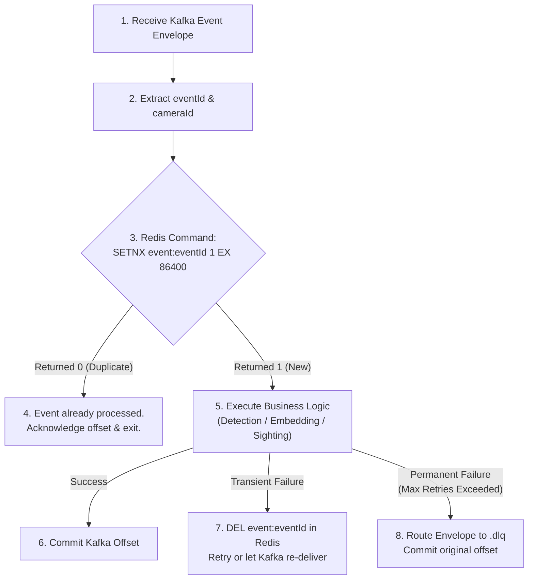

# 📡 Sentinel Vision AI — Event Contracts & Messaging Specification

This document defines the event streaming architecture, topics, canonical envelope, partitioning strategies, idempotency protocols, and dead-letter queue (DLQ) policies for Sentinel Vision AI.

---

## 1. Canonical Event Envelope

Every message published to Kafka must conform to the `EventEnvelope` schema.

```typescript
interface EventEnvelope<T = unknown> {
  /** Globally unique event identifier (UUID v4) — used for Redis deduplication */
  eventId: string;
  /** Topic or event type descriptor (e.g. 'video.frames.raw', 'detections.person') */
  type: string;
  /** Schema version for forward/backward compatibility (e.g. '1.0') */
  version: string;
  /** ISO-8601 UTC timestamp when the event occurred */
  occurredAt: string;
  /** Distributed correlation identifier for end-to-end tracing */
  correlationId: string;
  /** Optional associated case ID */
  caseId?: string;
  /** Optional camera stream ID — CRITICAL: Used as the Kafka partition key */
  cameraId?: string;
  /** Type-specific event payload */
  payload: T;
}
```

---

## 2. Topic Catalog & Partitioning Strategy

### Partitioning Key Rule: `cameraId`
To maintain absolute frame ordering and consistent state tracking per camera feed (e.g., ByteTrack tracker IDs), all camera-related topics MUST use `cameraId` as their Kafka record partition key:
$$\text{Partition} = \text{hash}(\text{cameraId}) \pmod{\text{NumPartitions}}$$

For topics not tied to a single camera (e.g. `search.jobs.*`), the partition key is `caseId` or `searchJobId`.

| Topic Name | Partition Key | Purpose & Producer | Consumer(s) |
|---|---|---|---|
| `search.jobs.commands` | `searchJobId` | Trigger search across vector indexes (Producer: API) | Inference search worker |
| `search.jobs.progress` | `searchJobId` | Report search job execution stage (Producer: Inference) | API Gateway (pushes to WebSocket) |
| `video.frames.raw` | `cameraId` | Extracted video frame metadata (Producer: Camera Ingest) | YOLO Person Detector worker |
| `detections.person` | `cameraId` | Detected person bounding box & crops (Producer: YOLO) | ArcFace face & OSNet Re-ID extractors |
| `embeddings.generated` | `cameraId` | Face or Re-ID vector metadata + Pinecone ID (Producer: Inference) | Candidate scoring & matcher |
| `candidates.scored` | `caseId` | Cosine similarity scoring & rank fusion (Producer: Matcher) | Sighting creation service |
| `sightings.created` | `caseId` | Candidate match proposed for operator review (Producer: API) | Real-time Dashboard, Alert Dispatcher |
| `journeys.updated` | `caseId` | Cross-camera path trajectory updates (Producer: Trajectory Engine) | Map & Timeline UI |
| `alerts.created` | `caseId` | Operator or automated notification trigger (Producer: Sighting Engine) | Webhook / Email delivery worker |
| `<topic>.dlq` | Same as parent | Unrecoverable failed messages (Producer: Error handler) | Operator dead-letter review |

---

## 3. Topic Payloads Detail

### 1. `search.jobs.commands`
```json
{
  "searchJobId": "c9bf9e57-1685-4c89-bafb-ff5af830be8a",
  "caseId": "case_67890",
  "referencePhotoKey": "reference-photos/case_67890/ref_01.jpg",
  "faceThreshold": 0.60,
  "reidThreshold": 0.50,
  "topK": 20,
  "cameraIds": ["cam_01", "cam_02"],
  "fromTime": "2026-10-28T00:00:00Z",
  "toTime": "2026-10-28T23:59:59Z",
  "requestedBy": "operator_smith"
}
```

### 2. `search.jobs.progress`
Status progression: `queued` $\to$ `extracting_features` $\to$ `searching_face_index` $\to$ `searching_reid_index` $\to$ `fusing_results` $\to$ `completed` | `failed`.
```json
{
  "searchJobId": "c9bf9e57-1685-4c89-bafb-ff5af830be8a",
  "caseId": "case_67890",
  "status": "fusing_results",
  "progressPercent": 85.0,
  "candidatesFound": 14,
  "errorMessage": null
}
```

### 3. `video.frames.raw`
```json
{
  "frameId": "frame_cam01_104820",
  "cameraId": "cam_01",
  "sequenceNumber": 104820,
  "frameS3Key": "frames/cam_01/104820.jpg",
  "width": 1920,
  "height": 1080,
  "capturedAt": "2026-10-28T10:48:20.120Z",
  "fps": 5.0
}
```

### 4. `detections.person`
```json
{
  "detectionId": "det_98712",
  "cameraId": "cam_01",
  "frameId": "frame_cam01_104820",
  "capturedAt": "2026-10-28T10:48:20.120Z",
  "personBbox": [320.5, 140.0, 540.0, 680.0],
  "personScore": 0.94,
  "cropS3Key": "crops/cam_01/det_98712.jpg",
  "bytetrackId": 42
}
```

### 5. `embeddings.generated`
> **CRITICAL**: `kind` must be either `"face"` or `"reid"`. Feature spaces are strictly separate and never mixed. `model_version` is mandatory.
```json
{
  "embeddingId": "emb_face_98712",
  "kind": "face",
  "caseId": "case_67890",
  "cameraId": "cam_01",
  "frameId": "frame_cam01_104820",
  "capturedAt": "2026-10-28T10:48:20.120Z",
  "cropS3Key": "crops/cam_01/det_98712_face.jpg",
  "model_version": "arcface-r100-v1",
  "pineconeId": "emb_face_98712",
  "pineconeIndex": "face-embeddings",
  "vectorDimension": 512,
  "detectionScore": 0.98,
  "bbox": [390.0, 160.0, 480.0, 270.0],
  "bytetrackId": 42
}
```

### 6. `candidates.scored`
```json
{
  "candidateId": "cand_11223",
  "caseId": "case_67890",
  "searchJobId": "c9bf9e57-1685-4c89-bafb-ff5af830be8a",
  "cameraId": "cam_01",
  "frameTimestamp": "2026-10-28T10:48:20.120Z",
  "faceScore": 0.74,
  "reidScore": 0.68,
  "fusedRank": 1,
  "confidenceBand": "high",
  "thumbnailKey": "sighting-thumbnails/cand_11223.jpg",
  "cropKey": "crops/cam_01/det_98712.jpg"
}
```

### 7. `sightings.created`
> **CRITICAL**: `displayLabel` must strictly equal `"Possible match"`. Status defaults to `"pending_review"`.
```json
{
  "sightingId": "sight_55443",
  "caseId": "case_67890",
  "cameraId": "cam_01",
  "detectedAt": "2026-10-28T10:48:20.120Z",
  "thumbnailKey": "sighting-thumbnails/cand_11223.jpg",
  "confidenceBand": "high",
  "displayLabel": "Possible match",
  "status": "pending_review",
  "faceEmbeddingId": "emb_face_98712",
  "reidEmbeddingId": "emb_reid_98712"
}
```

### 8. `journeys.updated`
```json
{
  "journeyId": "journ_case67890_01",
  "caseId": "case_67890",
  "cameraSequence": ["cam_01", "cam_03", "cam_04"],
  "sightings": [
    {
      "sightingId": "sight_55443",
      "cameraId": "cam_01",
      "timestamp": "2026-10-28T10:48:20Z",
      "confidenceBand": "high"
    },
    {
      "sightingId": "sight_55449",
      "cameraId": "cam_03",
      "timestamp": "2026-10-28T10:55:10Z",
      "confidenceBand": "medium"
    }
  ],
  "lastSeenCameraId": "cam_03",
  "lastSeenAt": "2026-10-28T10:55:10Z"
}
```

### 9. `alerts.created`
```json
{
  "alertId": "alt_99001",
  "caseId": "case_67890",
  "sightingId": "sight_55443",
  "message": "Possible match detected on Camera cam_01 (High confidence) pending operator review.",
  "confidenceBand": "high",
  "destination": {
    "type": "ui",
    "target": "operator_dashboard"
  }
}
```

---

## 4. Idempotency & Effectively-Once Processing Algorithm

Kafka provides **at-least-once delivery**. To achieve **effectively-once processing**, consumers implement the following idempotent deduplication algorithm via Redis:



### Idempotency Code Pattern (TypeScript / Python)
```typescript
async function processEventWithIdempotency(event: EventEnvelope<any>, redis: Redis, handler: Function) {
  const dedupKey = `event:dedup:${event.eventId}`;
  const isNew = await redis.set(dedupKey, '1', 'EX', 86400, 'NX');
  if (!isNew) {
    // Already processed or processing — safely drop duplicate
    return;
  }
  try {
    await handler(event.payload);
  } catch (err) {
    // Release dedup key on failure so retries can execute
    await redis.del(dedupKey);
    throw err;
  }
}
```

---

## 5. Retry and Dead-Letter Queue (DLQ) Policy

1. **Retry Attempts**: Up to **3 retries** with exponential backoff ($1\text{s}, 2\text{s}, 4\text{s}$).
2. **DLQ Routing**: If an event fails after 3 attempts or experiences an unrecoverable validation/parse error:
   - The original event envelope is packaged into `DeadLetterQueuePayload`.
   - Published to topic: `<original_topic>.dlq` (e.g. `video.frames.raw.dlq`).
   - The consumer commits the original Kafka offset to avoid consumer group blockage.
   - An alert is logged for operator investigation.
